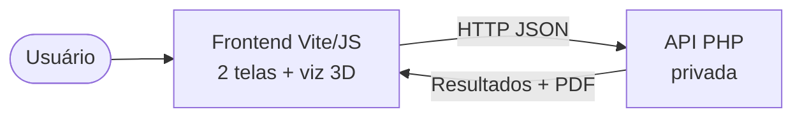

# Heat Pumps Simulator

Simulador web que **dimensiona bombas de calor para aquecimento de piscinas**. A partir da localização, das dimensões da piscina e das condições de uso, o sistema recomenda a(s) bomba(s) ideal(is), estima custos de operação, compara com outras fontes de aquecimento e gera um relatório em PDF.

A tela de dimensionamento traz uma **visualização isométrica 3D da piscina em tempo real**, feita em SVG puro.

> Este repositório contém apenas o **frontend**. A API em PHP é privada, pois contém as regras de cálculo do dimensionamento.

<!-- Adicione aqui um print ou GIF das telas -->

---

## Como funciona

O frontend se comunica com uma API REST em PHP, mantida em um repositório privado por conter as regras de cálculo do dimensionamento:



Fluxo de uma simulação:

1. **Tela 1 (Dimensionamento):** o usuário escolhe estado e cidade, adiciona uma ou mais áreas da piscina (comprimento × largura × profundidade) e informa os parâmetros de uso. A **visualização 3D** atualiza ao vivo.
2. O frontend valida os dados e envia a simulação para a API.
3. A API retorna as **bombas recomendadas** e a estimativa de **custos**, com o comparativo entre fontes de aquecimento.
4. **Tela 2 (Resultados):** mostra as bombas recomendadas, gráficos comparativos e permite **baixar o relatório em PDF**.

---

## Destaques

- **Visualização 3D em tempo real:** a piscina é redesenhada a cada alteração, com todas as áreas conectadas como um corpo único, prainha, hidromassagem, cascata, borda infinita, capa térmica e indicação de vento.
- **Design system próprio:** componentes reutilizáveis (inputs, botões, cards) com classes `.eco-*`.
- **Validação no cliente:** os dados são conferidos antes de seguir para a API, com avisos e erros exibidos em notificações inline.

---

## Stack

- [Vite](https://vitejs.dev/) com JavaScript puro (ES modules, sem framework)
- [Chart.js](https://www.chartjs.org/) para os gráficos
- [Lucide](https://lucide.dev/) para os ícones
- SVG puro para a visualização 3D

> A stack (JavaScript puro no frontend e PHP no backend) foi definida a pedido da equipe responsável pela hospedagem do site oficial da empresa, para manter compatibilidade com a infraestrutura existente.

---

## Estrutura

```
├── index.html                 Documento raiz que carrega src/main.js
├── src/
│   ├── main.js                Entrypoint: instancia o App, registra ícones e fontes
│   ├── js/
│   │   ├── app.js             Navegação entre as 2 telas, cabeçalho/stepper e rodapé
│   │   ├── api.js             Chamadas HTTP à API (usa VITE_API_BASE_URL)
│   │   ├── config.js          Constantes compartilhadas
│   │   ├── toast.js           Notificações inline (avisos e erros)
│   │   └── components/
│   │       ├── screen-dimensionamento.js  Tela 1: formulário + visualização 3D
│   │       ├── pool-viz.js                Visualização isométrica 3D em SVG
│   │       └── step-result.js             Tela 2: resultados, gráficos e PDF
│   ├── css/
│   │   ├── components.css              Design system (.eco-*)
│   │   ├── screen-dimensionamento.css  Layout das telas
│   │   └── pool-viz.css                Estilos e animações da visualização 3D
│   └── assets/images/         Logos
├── public/assets/images/pumps/  Fotos das bombas
├── vite.config.js             Config do Vite (base './' e proxy de dev)
└── package.json
```

---

## Rodando localmente

**Pré-requisito:** Node 18+

```bash
npm install
npm run dev     # sobe em http://localhost:5173
```

> Como a API é privada, as telas carregam normalmente, mas a busca de cidades, a simulação e o relatório dependem dela.

## Build

```bash
npm run build   # gera dist/ com caminhos relativos
```

A URL da API é definida em `VITE_API_BASE_URL`. Copie o `.env.example` para `.env.development` ou `.env.production` e ajuste o valor.